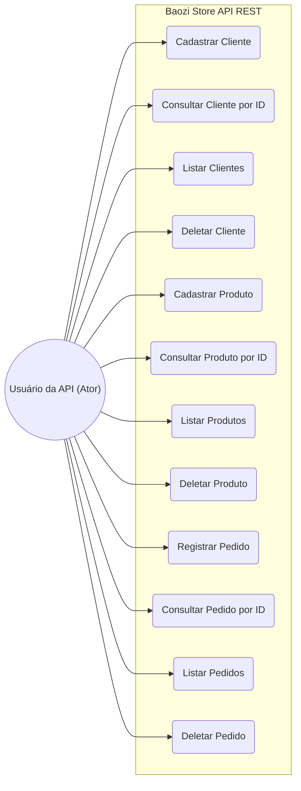

# RELATÓRIO DO TRABALHO PRÁTICO - DESENVOLVIMENTO WEB BACK-END
**API REST – Baozi Store**
**Aluno:** Thiago Felipe  
**RU:** 5417147  
**Instituição:** UNINTER  

---

## 1. Descrição da Situação Fictícia

> A Baozi Store é uma pequena loja que vende pão chinês. Para melhorar a organização do negócio, foi criado um sistema simples para controlar clientes, produtos e pedidos.  
> O cliente chamado **Thiago Felipe RU5417147** realizou seu cadastro no sistema. O produto vendido pela loja chama-se **Baozi Tradicional de Carne** e é vendido por unidade no valor de R$ 8,50.  
> Em um determinado momento, o cliente realizou um pedido de **5** unidades do produto.  
> O sistema registra o cliente, o produto comprado e a quantidade solicitada, facilitando o controle da loja.

---

## 2. Diagrama de Casos de Uso (UML)

---

## 3. Especificação da API Desenvolvida

### Entidades e Campos:

1. **Cliente** (`package com.baozi.store.model`)
   - `id` (Long) - Chave Primária Autoincremento
   - `nome` (String) - Nome do cliente
   - `clienteDesde` (LocalDate) - Data de cadastro (AAAA-MM-DD)

2. **Produto** (`package com.baozi.store.model`)
   - `id` (Long) - Chave Primária Autoincremento
   - `nome` (String) - Nome do produto
   - `preco` (BigDecimal) - Preço unitário
   - `estoque` (Boolean) - Indicador de disponibilidade em estoque

3. **Pedido** (`package com.baozi.store.model`)
   - `id` (Long) - Chave Primária Autoincremento
   - `clienteId` (Long) - ID do Cliente comprador
   - `produtoId` (Long) - ID do Produto comprado
   - `quantidade` (Integer) - Quantidade comprada

---

### Endpoints Implementados (Padrão REST):

| Entidade | Método HTTP | URL Endpoint | Descrição / Ação |
| :--- | :--- | :--- | :--- |
| **Cliente** | `POST` | `/clientes` | Cadastra um novo cliente |
| **Cliente** | `GET` | `/clientes` | Lista todos os clientes cadastrados |
| **Cliente** | `GET` | `/clientes/{id}` | Busca cliente específico por ID |
| **Cliente** | `PUT` | `/clientes/{id}` | Atualiza dados do cliente por ID |
| **Cliente** | `DELETE` | `/clientes/{id}` | Remove cliente por ID |
| **Produto** | `POST` | `/produtos` | Cadastra um novo produto |
| **Produto** | `GET` | `/produtos` | Lista todos os produtos |
| **Produto** | `GET` | `/produtos/{id}` | Busca produto específico por ID |
| **Produto** | `PUT` | `/produtos/{id}` | Atualiza produto por ID |
| **Produto** | `DELETE` | `/produtos/{id}` | Remove produto por ID |
| **Pedido** | `POST` | `/pedidos` | Registra um novo pedido |
| **Pedido** | `GET` | `/pedidos` | Lista todos os pedidos |
| **Pedido** | `GET` | `/pedidos/{id}` | Busca pedido específico por ID |
| **Pedido** | `PUT` | `/pedidos/{id}` | Atualiza pedido por ID |
| **Pedido** | `DELETE` | `/pedidos/{id}` | Remove pedido por ID |

---

## 4. Guia para Capturas de Tela do Postman (Prints Obrigatórios)

Para incluir no PDF final, realize as seguintes requisições e tire um print da tela do Postman mostrando o **Status: 200 OK / 201 Created** e o corpo da resposta em JSON:

1. **Print 1 - POST Cliente**:  
   - URL: `http://localhost:8080/clientes` (Body Raw JSON: `{"nome": "Thiago Felipe RU5417147", "clienteDesde": "2026-10-09"}`)
2. **Print 2 - POST Produto**:  
   - URL: `http://localhost:8080/produtos` (Body Raw JSON: `{"nome": "Baozi Tradicional de Carne", "preco": 8.50, "estoque": true}`)
3. **Print 3 - POST Pedido**:  
   - URL: `http://localhost:8080/pedidos` (Body Raw JSON: `{"clienteId": 1, "produtoId": 1, "quantidade": 5}`)
4. **Print 4 - GET Geral (Listagem de Clientes/Produtos/Pedidos)**:  
   - URL: `http://localhost:8080/clientes` (ou `/produtos` / `/pedidos`)
5. **Print 5 - GET por ID**:  
   - URL: `http://localhost:8080/clientes/1`
6. **Print 6 - DELETE**:  
   - URL: `http://localhost:8080/pedidos/1`

---

## 5. Link do Repositório GitHub
- `https://github.com/SEU_USUARIO_GITHUB/baozi-store-api` (Suba a pasta do seu projeto)
